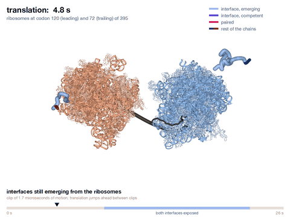

# Co-translational dimerisation revisited

Draft manuscript, simulations and data analysis that test the model of

> Stoof R, Goñi-Moreno Á. Modelling co-translational dimerization for programmable nonlinearity in synthetic biology. *J. R. Soc. Interface* 17:20200561 (2020)

against ribosome-profiling data and ribosome structures, and propose a replacement for its overlapping-spheres mechanism.

- **Manuscript:** [paper/manuscript.md](paper/manuscript.md)
- **Open points for the author:** [paper/notes_for_author.md](paper/notes_for_author.md)
- **Movie:** [paper/figures/movie.mp4](paper/figures/movie.mp4), a three-dimensional time-lapse of two nascent chains that dimerise during translation (preview below)

This is an unreviewed draft. It was produced with Claude (Anthropic); see the notes for what still needs checking.

## The proposed model in one paragraph

A nascent chain can dimerise only while its dimerisation interface is outside the ribosome: from the moment the interface has left the exit tunnel until the chain is released. With initiation rate λ, competence window W = (L − n_i − n_t)/v and pairing rate k = k_on·c_eff, the expected number of following ribosomes that pair in time is Λ = λ[W − (1 − e^(−kW))/k], and the fraction of chains released in a co-translational dimer is α = 2q/(1+q) with q = 1 − e^(−Λ). The effective concentration c_eff (about 1 µM for ribosomes tens to hundreds of codons apart) follows from the atomic structure of two neighbouring *E. coli* ribosomes. The model is in `ctd/window.py`.

## Layout

| Path | Content |
|---|---|
| `paper/` | manuscript, figures, `make_figures.py`, `quoted_numbers.py` |
| `ctd/window.py` | the competence-window model (closed form) |
| `ctd/polysome2.c`, `ctd/sim2.py` | stochastic simulation of a polysome and of a gene with coupled transcription and translation |
| `ctd/disp.py` | re-analysis of the Disome Selective Profiling data of Bertolini et al. 2021 |
| `ctd/structure.py`, `ctd/pairgeom.py` | mmCIF reader, tunnel exits, nascent chains around the real ribosome shape |
| `ctd/chain3d.c`, `ctd/chain3d.py` | three-dimensional dynamics of two nascent chains on a tethered pair of ribosomes |
| `paper/render/` | molecular graphics: `render.py` (Figure 2A), `movie.py` (Figure 4A–F and the movie) |
| `ctd/geometry.py`, `ctd/polysome.c`, `ctd/circuits.py` | the 2020 model: equations 1–3, the repressilator and the toggle switch |
| `compute_*.py` | run the analyses and write `results/*.pkl` |
| `data/` | derived data (per-codon footprint counts, effective-concentration table) and PDB files |
| `results/*.pkl` | results behind every figure and number |
| `report.html`, `figures.py`, `figures2.py`, `build_report.py` | an earlier report of the same work, in Dutch |

## Reproducing

Requires Python 3 with numpy, scipy and matplotlib, and a C compiler (`cc`).

    python3 paper/make_figures.py        # figures from the stored results
    python3 paper/quoted_numbers.py      # every number quoted in the manuscript

To recompute from the stored derived data:

    python3 compute_geometry.py          # PDB 9GFT: tunnel exits, distances, Monte Carlo (about 5 minutes)
    python3 compute_kernel.py            # effective concentration as a table (about 6 minutes)
    python3 compute_tests.py             # tests against the profiling data
    python3 compute_model.py             # validation of the closed form against simulations
    python3 compute_3d.py                # three-dimensional simulations (about 90 minutes on 8 cores)
    python3 compute.py                   # the 2020 model (first part of the work)

The molecular graphics are stored in `paper/figures/` (`render_structure.png`, `snapshot_*.png`, `movie.*`), so the figures can be rebuilt without rendering. To render them again (needs Google Chrome, and internet access for the NGL viewer, which is loaded from unpkg.com):

    python3 paper/render/render.py       # the two ribosomes of Figure 2A
    python3 paper/render/movie.py        # snapshots of Figure 4 and the movie (also needs ffmpeg)

To rebuild the derived data from the public sources (needs `h5py`):

    python3 -m venv --system-site-packages .venv && .venv/bin/pip install h5py
    python3 fetch_data.py all            # GEO GSE151959 (about 380 MB) and Table S1 of Bertolini et al.
    .venv/bin/python -I extract_disp.py
    .venv/bin/python -I extract_human.py

## Data sources

- Bertolini M et al. *Science* 371:57–64 (2021): footprint profiles from GEO GSE151959; Table S1 is downloaded by `fetch_data.py` and not redistributed here.
- Campbell A et al. *Mol. Cell* 85:999–1007 (2025): PDB 9GFT, two collided *E. coli* ribosomes.
- PDB 4AC0 (TetR), 1LBI (LacI), 3BDN (λ cI).

No licence has been chosen yet; all rights are reserved by the author until one is added.
