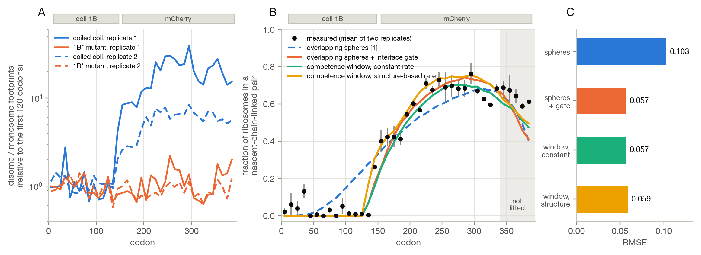
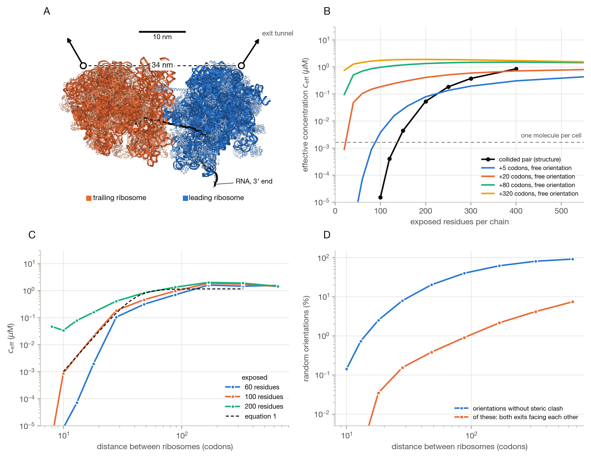
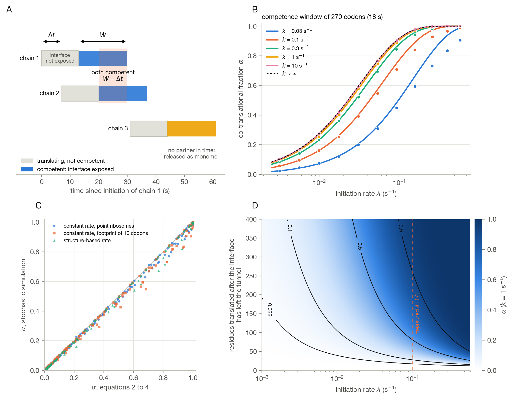
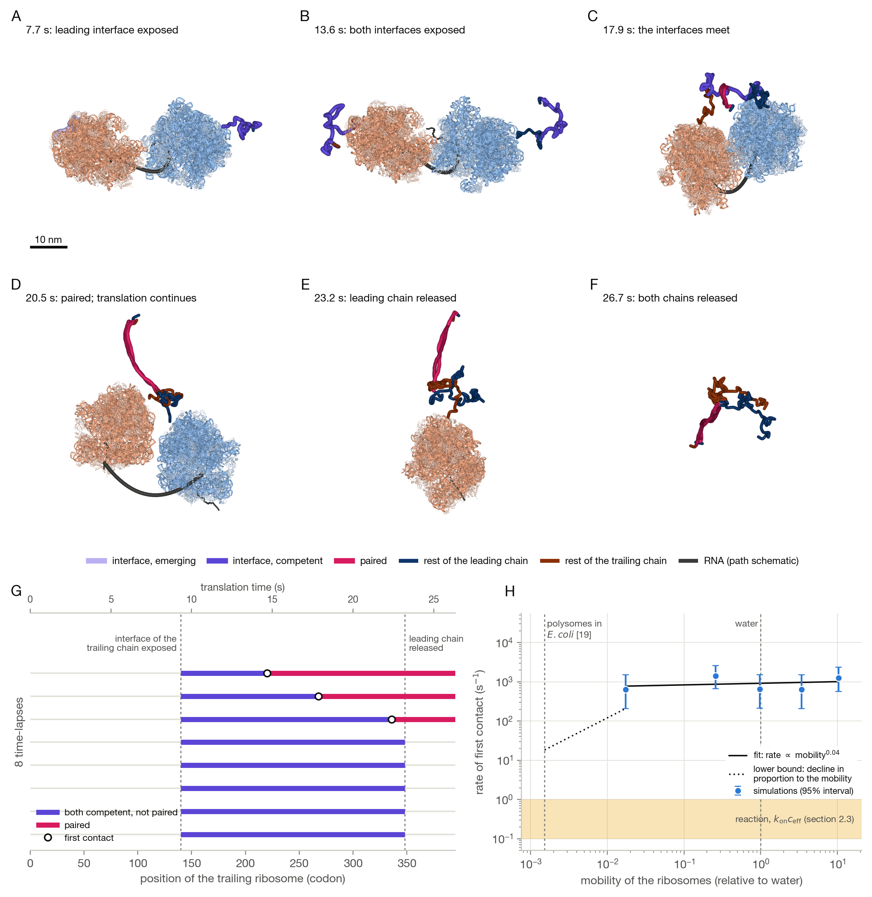
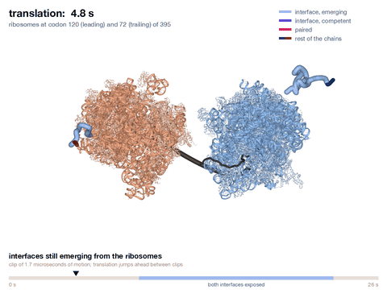
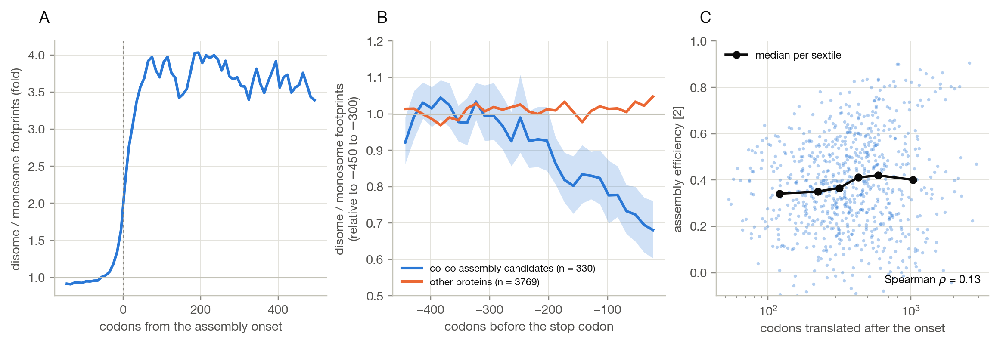
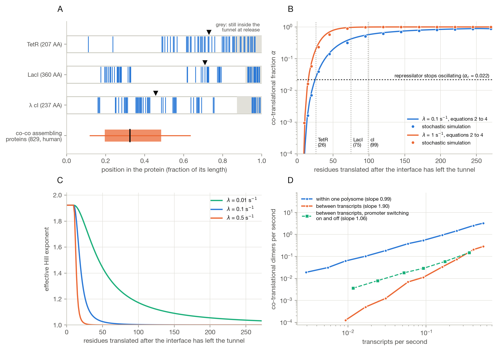

# An interface-exposure model of co-translational dimerisation for programmable nonlinearity in synthetic biology

Ruud Stoof1,\* [co-authors to be confirmed]

1 [affiliation]

\* To whom correspondence should be addressed: [e-mail]

*Draft, 27 November 2026. Not peer reviewed. Open points are listed in [notes_for_author.md](notes_for_author.md).*

## Abstract

Nonlinearity plays a fundamental role in the performance of genetic circuits, and the dimerisation of regulatory proteins is one of its best-known sources. We previously introduced a model in which protein dimers also form during—and not only after—translation, and showed that the fraction of such co-translational dimers ($\alpha$) controls how nonlinear a circuit can be. That model described partially formed monomers as overlapping spheres, an assumption that could not be tested at the time. Here, we test it against data that have since become available: ribosome profiling of ribosome pairs linked by their nascent chains, and atomic structures of neighbouring ribosomes. The core idea holds: in *Escherichia coli*, about 70% of the ribosomes that translate a coiled-coil protein are linked to another ribosome through their nascent chains. The mechanism does not. Dimerisation starts abruptly when the dimerisation interface leaves the ribosome, rather than gradually as the chains grow, and the exit tunnels of two neighbouring ribosomes lie 33.8 nm apart and point away from each other. We therefore propose a replacement, the competence-window model, in which $\alpha$ depends on the initiation rate of translation and on the time between the exposure of the interface and the release of the chain. The model has a closed form, reproduces stochastic simulations and the measured profiles, and keeps $\alpha$ as a quantity that can be designed. Three-dimensional simulations of two ribosomes and their nascent chains support its central assumption: competent chains meet about a thousand times per second, far more often than they react, so that the reaction and not the encounter sets the rate. Specifically, it adds the position of the dimerisation interface as a design rule: interfaces near the N-terminus impose linear dynamics, whereas interfaces near the C-terminus—as in TetR, LacI and λ cI—preserve nonlinearity.

## 1 Introduction

Nonlinear dynamics are at the core of the genetic circuits that synthetic biology builds. In previous work [1], we argued that the place where two protein monomers meet matters for that nonlinearity. If two monomers dimerise in the cytosol (i.e., post-translational dimerisation), the amount of dimer grows with the square of the amount of monomer. If, instead, two partially formed monomers dimerise while they are still being translated by neighbouring ribosomes (i.e., co-translational dimerisation), each RNA delivers dimers directly, and their amount grows linearly with gene expression. The fraction of dimers formed through the second route, which we called $\alpha$, therefore sets how nonlinear a circuit can be. That such dimers exist is now supported by experiments: Bertolini et al. [2] showed that hundreds of human homodimers assemble while both subunits are still bound to ribosomes.

The relevance of this for circuit design is direct. Oscillators such as the repressilator [3] and memory devices such as the toggle switch [4] only work if the response of a promoter to its regulator is steeper than linear, and the dimerisation of regulatory proteins is one of the best-known sources of such a response [5, 6]. In a model of the repressilator, oscillations vanished when $\alpha$ exceeded 0.022 [1]. This is, a small fraction of dimers formed at the ribosome was enough to change the qualitative behaviour of the circuit.

To calculate $\alpha$, the model in [1] described each nascent protein as a sphere centred on its ribosome, with a radius equal to the length of the chain translated so far. Two ribosomes that bound the same RNA shortly after each other were assumed to sit close together along a straight RNA, and the overlap of their spheres determined the probability of dimerisation. These geometrical assumptions seemed reasonable, but they could not be tested at the time. The question of where monomers meet had been raised long ago [7] and had experimental support for individual proteins [8, 9]; yet there was no measurement of how often, and at which point of translation, two nascent chains engage each other.

That measurement now exists. Disome Selective Profiling (DiSP) [2] detects pairs of ribosomes held together by their nascent chains, extending earlier evidence for the co-translational assembly of protein complexes [10, 11]. Importantly for the organisms in which most genetic circuits are built, the process was also reconstituted in *Escherichia coli* [2]. In addition, the three-dimensional arrangement of ribosomes that translate the same RNA has been described by electron tomography [12], and atomic models of two neighbouring *E. coli* ribosomes on one RNA are available [13].

Here, we use these data to test the model of [1] and, where it fails, to replace it. We show that its central prediction holds, whereas its mechanism does not, and we introduce a model based on the exposure of the dimerisation interface that is simpler, agrees with the measurements, and translates into design rules. Three-dimensional simulations of two ribosomes and their nascent chains show the process at the molecular scale and support the assumptions of the model. To put the modelling of co-translational dimerisation on this experimental footing is the target of the present research.

## 2 Results and Discussion

### 2.1 The overlap of spheres does not explain when nascent chains dimerise

The model in [1] makes a prediction that can be confronted with experiments directly: at each codon of a gene, a certain fraction of the ribosomes should carry a nascent chain that is already bound to the nascent chain of a neighbouring ribosome. This is precisely what DiSP measures [2]. In this method, the RNA between ribosomes is digested, so that two ribosomes only stay together if their nascent chains hold them; single ribosomes (monosomes) and pairs (disomes) are then separated, and the RNA fragments protected by each are sequenced [14]. The ratio of disome to monosome footprints along a coding sequence reveals where nascent chains start to interact.

Bertolini et al. [2] applied DiSP to *E. coli* cells that expressed human proteins. We re-analysed their deposited footprint profiles (Methods). Figure 1A shows the result for coil 1B of lamin—a segment of 138 residues that forms a parallel coiled-coil dimer—fused to the fluorescent protein mCherry. Up to codon 130 the ratio of disome to monosome footprints is flat. It then rises steeply, by a factor of 25 and 6.7 in the two replicates. A control construct in which the same amino acids are arranged so that no coiled coil can form (1B\*) shows no rise at all (0.92 and 1.17 times the initial ratio). Since both constructs share an identical mCherry sequence, the loss of monosome footprints in the wild type relative to the control gives the fraction of ribosomes that left the monosome fraction: 0.73 ± 0.01 and 0.65 ± 0.02 (Figure 1B). This is, about 70% of the ribosomes that translate the second half of this gene are linked to another ribosome through their nascent chains. The existence and the magnitude of co-translational dimerisation in bacteria, which were assumptions in [1], are thereby supported by measurement.

**Figure 1: Co-translational dimerisation measured in *E. coli*, and the overlap of spheres.** **A.** Ratio of disome to monosome footprints along coil 1B–mCherry (blue) and along the 1B\* control, which cannot form a coiled coil (orange). Data from [2], bins of 10 codons, two replicates. The bars on top mark the domains of the construct. **B.** Fraction of ribosomes linked to another ribosome through their nascent chains (dots: mean of the two replicates; vertical lines: their range), together with four models fitted between codons 20 and 340. **C.** Root-mean-square error (RMSE) of each fit.

The shape of the profile, however, is not what the model predicts. To compare both, we simulated the translation of this construct (Methods) and recorded, for each codon, the fraction of ribosomes whose nascent chain was bound to that of another ribosome still on the RNA—the quantity that DiSP reports. With the overlap of spheres as the rule for dimerisation, the best fit (Figure 1B, dashed line) rises gradually from codon 50 onwards and misses the jump at codon 140; its root-mean-square error is 0.103. The reason is that spheres whose radius is the contour length of the chain start to overlap as soon as the chains are longer than the distance between the ribosomes, regardless of which part of the protein has been made. The measured transition is centred at codons 146 and 159. Taking into account the ca. 30 residues that are hidden inside the ribosomal exit tunnel [15], 106 to 119 of the 138 residues of the coiled coil are then outside the ribosome. Lamin C and the dynactin subunit p150 behave alike: their transitions (codons 149–165 and 473 of the respective constructs) coincide with the exposure of their coiled-coil domains and with the onsets measured in human cells [2].

If the model is given a gate—no dimerisation until both chains expose 100 residues—the error halves (0.057; Figure 1C), which is close to the difference between the two replicates (0.034). What sets the start of co-translational dimerisation is therefore the exposure of the interface, as the 1B\* control already suggests, and not the growth of the chain.

Note that these experiments rely on strong overexpression: between 10 and 46% of all ribosome footprints map to the construct. At such levels nascent chains of the same protein are abundant throughout the cell, and DiSP cannot tell whether the two ribosomes of a pair translate the same RNA. That they do was shown in human cells, where differently tagged copies of lamin C never formed mixed dimers [2]; for *E. coli* it remains an assumption.

### 2.2 The structure of the ribosome sets where nascent chains can meet

A second assumption of [1] is geometrical. Two ribosomes that initiate translation shortly after each other were placed 9 Å per codon apart along a straight RNA, and each nascent chain could reach as far as its contour length. Electron tomography of bacterial polysomes suggested a different picture: neighbouring ribosomes are densely packed, with the RNA on the inside and the polypeptide exit sites facing the cytosol, an arrangement proposed to maximise the distance between nascent chains [12]. We quantified this with the atomic model of two *E. coli* ribosomes that have collided on one RNA [13, 16]—the closest that two ribosomes can get (Figure 2A). In that structure the centres of the ribosomes are 20.8 nm apart, but the two exit tunnels are separated by 33.8 nm, and each points away from the other (123° and 120° with respect to the line that joins them). 55% of that line runs through the ribosomes themselves, and the shortest path between the exits that avoids them measures 36.6 nm: two fully stretched chains of 51 residues each would be needed to span it. By contrast, the model in [1] places these two ribosomes 7.2 nm apart.

**Figure 2: Geometry of nascent-chain encounters.** **A.** Two collided *E. coli* ribosomes on one RNA (PDB 9GFT [13]), drawn as ribbons with a stub for every base: RNA in full colour, ribosomal proteins in a lighter tint. The view is at a right angle to the plane that contains both exit tunnels. Circles mark the tunnel exits and arrows the direction of the tunnels. **B.** Effective concentration of the N-terminus of one nascent chain around the N-terminus of the other, for two chains of equal exposed length. Black: collided pair. Colours: ribosomes that are further apart on the RNA and free to rotate. **C.** The same quantity as a function of the distance between the ribosomes; the first point is the collided pair, the dashed line is equation 1. **D.** Fraction of random orientations of the trailing ribosome that are sterically possible, and fraction of those in which both tunnel exits face each other.

To translate geometry into reaction rates, we calculated the effective concentration ($c_{\mathrm{eff}}$) of the N-terminus of one nascent chain around that of the other, with chains modelled as unfolded polymers that cannot penetrate the ribosomes (Methods). For the collided pair, $c_{\mathrm{eff}}$ is negligible for short chains: 0.41 nM for 120 exposed residues and 4.4 nM for 150, to be compared with 1.7 nM for a single molecule in an *E. coli* cell (Figure 2B). Neighbouring ribosomes at their closest are thus shielded from each other, in agreement with [12].

Ribosomes that are further apart on the RNA are not locked in this arrangement. We therefore sampled random orientations of the trailing ribosome, restricted only by the length of the RNA between both ribosomes and by the condition that they do not overlap. Two results stand out. First, the exits tend to face away from each other even without any ordering: both point towards the other in only 0.2% of the allowed orientations when the ribosomes are 28 codons apart, and in 2.2% at 168 codons (Figure 2D). This follows from where the RNA is held—on the small subunit, opposite to the exit tunnel. Second, the rare favourable orientations dominate the average (the best 1% contribute 78 to 97%), and they suffice: for chains of 100 exposed residues, $c_{\mathrm{eff}}$ is 3.8 nM at 13 codons, 186 nM at 28 codons, and between 1 and 2 µM from 90 to 650 codons (Figure 2C). Its dependence on the distance $s$ between the ribosomes (in codons) is well described by

$$
c_{\mathrm{eff}}(s) = \frac{c_{\infty}}{1 + (s_0/s)^{m}} \tag{1}
$$

with $c_{\infty}$ = 1.2 µM, $s_0$ = 41 codons and $m$ = 5. Hence, the dependence on distance is opposite to the one assumed in [1]: the closest ribosomes are shielded from each other, and the most favourable neighbours are those located tens to hundreds of codons away.

### 2.3 A competence-window model for co-translational dimerisation

The two previous sections suggest which ingredients a model of co-translational dimerisation needs: [i] a nascent chain can only dimerise once its interface has left the ribosome; [ii] from then on, any other chain on the same RNA that also exposes its interface is a potential partner, almost irrespective of the distance between both; and [iii] the reaction between them is fast compared to translation. We propose a model built on these three points (Figure 3A), which we term the competence-window model.

As in [1], ribosomes bind the RNA following a Poisson process with rate $\lambda$, so that the time $\Delta t$ between two consecutive ribosomes is exponentially distributed, and they translate at a constant rate $v$. A nascent chain is competent for dimerisation from the moment its interface is exposed until the chain is released. If the interface is complete once $n_i$ residues have been translated, and $n_t$ residues are held inside the exit tunnel, the duration of this competence window is

$$
W = \frac{L - n_i - n_t}{v} \tag{2}
$$

where $L$ is the length of the protein. Two competent chains on the same RNA dimerise with rate $k = k_{\mathrm{on}}\, c_{\mathrm{eff}}$, where $k_{\mathrm{on}}$ is the association rate constant of the interface and $c_{\mathrm{eff}}$ the effective concentration of equation 1. A ribosome that follows an unpaired chain at a time $\Delta t < W$ shares a time $W - \Delta t$ of its window with it. The expected number of following ribosomes that would dimerise with that chain in time is

$$
\Lambda = \lambda \int_0^{W} \left[ 1 - e^{-k(v\Delta t)\,(W - \Delta t)} \right] \mathrm{d}\Delta t \tag{3}
$$

which, for a rate $k$ that does not depend on the distance between ribosomes, becomes $\Lambda = \lambda \left[ W - (1 - e^{-kW})/k \right]$. The probability that an unpaired chain finds a partner before it is released is then $q = 1 - e^{-\Lambda}$. Finally, each dimer takes two chains: a chain that has been paired is no longer available for the ribosome behind it, which starts again as an unpaired chain. Counting chains along the RNA accordingly (Methods), the fraction of chains that leave the ribosome as part of a co-translational dimer is

$$
\alpha = \frac{2q}{1 + q}, \qquad q = 1 - e^{-\Lambda} \tag{4}
$$

Equations 2–4 replace equation 3 of [1]. They have two useful limits. When the reaction is fast ($kW \gg 1$), $\Lambda = \lambda W$: $\alpha$ only depends on the number of ribosomes that bind the RNA during one competence window, and approaches $2\lambda W$ when that number is small. When the reaction is slow ($kW \ll 1$), $\Lambda = \lambda k W^2/2$ and $\alpha \approx \lambda k W^2$. In both cases $\alpha$ increases with the initiation rate, as in [1]; however, the length of the protein only matters through the residues that are translated after the interface.

**Figure 3: The competence-window model.** **A.** Three consecutive nascent chains on one RNA. A chain becomes competent for dimerisation when its interface has left the exit tunnel (blue), and remains so for a time $W$ until it is released. Chains 1 and 2, initiated $\Delta t$ apart, are both competent for $W - \Delta t$ and can dimerise; chain 3 finds no partner in time. **B.** Fraction of chains released as part of a co-translational dimer ($\alpha$) for a window of 270 codons and different reaction rates $k$. Lines: equations 2–4. Dots: stochastic simulations. **C.** Equations 2–4 against stochastic simulations for all 572 combinations of initiation rate, window and reaction rate. **D.** $\alpha$ as a function of the initiation rate and of the number of residues translated after the interface has left the tunnel ($k$ = 1 s⁻¹, 15 residues per second). The dashed line marks the initiation rate measured in *E. coli* [17]; contours at $\alpha$ = 0.022, 0.1, 0.5 and 0.9.

Figure 3B–C compares equations 2–4 with stochastic simulations of polysomes in which every pair of competent chains can react (Methods). Over 572 combinations of initiation rate, window and reaction rate, the root-mean-square difference in $\alpha$ is 0.014 for point-like ribosomes, 0.024 when ribosomes occupy 10 codons, and 0.020 when the reaction rate follows the structure-based effective concentration; the largest deviations (up to 0.13) occur when many ribosomes react slowly. For windows longer than 120 codons, a constant $c_{\mathrm{eff}}$ of 1 µM is sufficient (root-mean-square difference 0.025). With a typical association rate constant for proteins of 10⁵ to 10⁶ M⁻¹ s⁻¹ [18], this gives $k$ between 0.1 and 1 s⁻¹: the reaction takes seconds, whereas translation takes tens of seconds.

The model reproduces the profile measured in *E. coli* (Figure 1B). With a competence that starts at 100 exposed residues, the fits return $k$ = 0.11 s⁻¹ for a constant rate, or $k_{\mathrm{on}}$ = 10⁶ M⁻¹ s⁻¹ if the rate follows the structure-based effective concentration (root-mean-square errors 0.057 and 0.059)—values within the expected range. In those fits, 94 to 98% of the chains end up in a co-translational dimer, although the measured plateau is 0.73: DiSP only counts pairs in which both ribosomes are still on the RNA, and therefore underestimates $\alpha$. One feature is not reproduced. Shortly before the stop codon the trailing ribosome of a pair loses its partner, which makes all models drop to 0.50, whereas the measurement stays at 0.61; slow termination, which would let the trailing ribosome catch up, is a possible explanation.

Figure 3D shows $\alpha$ as a function of the initiation rate and of the number of residues translated after the interface, in analogy to Figure 2 of [1]. At the initiation rate measured in *E. coli* ($\lambda \approx$ 0.1 s⁻¹ [17]), $\alpha$ exceeds 0.5 as soon as some 100 residues follow the interface. The values are also far higher than those of [1]: for a protein of 400 residues whose interface is exposed after 100, stochastic simulations with the structure-based rate give $\alpha$ = 0.31, 0.72 and 0.93 at $\lambda$ = 0.013, 0.05 and 0.13 s⁻¹, where equation 3 of [1] gives 0.02, 0.09 and 0.18 for the same distance between ribosomes (with its reaction parameter set to 1). The new model thus predicts that co-translational dimerisation is either dominant or negligible, with the position of the interface deciding between both.

### 2.4 Two competent chains meet within milliseconds

Equations 2–4 reduce the encounter of two nascent chains to a single rate. To see what that rate stands for, and whether finding a partner can limit it, we simulated the process in three dimensions (Figure 4 and Movie 1). Two ribosomes with the shape of the atomic model of section 2.2 translate coil 1B–mCherry 48 codons apart. Both diffuse and rotate as they would in water, held together by the RNA between them, and their nascent chains are flexible strings of beads that cannot enter either ribosome (Methods). The interfaces of the two chains pair, in register, when they touch, provided that both chains expose at least 100 residues of the coiled coil—the onset measured by DiSP (section 2.1).

Chain motion and translation are far apart in time: a ribosome turns within microseconds, whereas the addition of one residue takes 67 ms. The simulation is therefore a time-lapse: after every four codons, it follows chains and ribosomes for 30 µs while both chains are competent, and for 1.7 µs otherwise. Figure 4A–F shows one such time-lapse. The leading chain exposes its interface first (Figure 4A), and the trailing chain 3.2 s later (Figure 4B). From then on, both chains are competent, but most of the time their interfaces are out of reach of each other, because the tunnel exits point to different sides (section 2.2): while the chains waited for each other, the exits were 42 nm apart on average (10th to 90th percentile 33–51 nm), whereas at the first contact they were 20 to 23 nm apart (Figure 4C). Pairing then spreads over the whole interface within 0.3 µs, and the two ribosomes remain joined by their nascent chains (Figure 4D)—the species that DiSP isolates. When the leading ribosome terminates, its chain stays bound to that of the trailing ribosome (Figure 4E), and the dimer is set free when the latter terminates as well (Figure 4F). Of eight time-lapses, three ended in a co-translational dimer. The chains paired when the trailing ribosome was at codon 220, 268 and 336: at different moments of the window in which both interfaces are exposed, but never before (Figure 4G). Since every contact leads to pairing, these moments are set by the compression of time and not by the chemistry of the interface. Counted in translation time, the chains paired at 0.03 s⁻¹ (95% confidence interval 0.006–0.09 s⁻¹), a value that only reflects the chosen compression.

How fast is the encounter itself? With the ribosomes held at codons 248 and 200, so that both chains keep their complete interface exposed, the interfaces touched for the first time after 1.1 ms on average: the rate of first contact is 910 s⁻¹ (95% confidence interval 630–1270 s⁻¹; 34 contacts in 37.5 ms of simulated time). In the time-lapses, in which the chains grow, it was 280 s⁻¹ (60–810 s⁻¹). Interestingly, the rate hardly depends on how fast the ribosomes move: when their diffusion coefficients were set between 0.017 and 10 times those in water, while those of the chains were left unchanged, the rate scaled with the mobility of the ribosomes to the power 0.04 (95% confidence interval −0.11 to 0.20; Figure 4H). Even the slowest of these ribosomes turn by one radian within 80 µs, i.e. long before the chains find each other, so that every encounter averages over the orientations of the pair.

Two conclusions follow. First, competent chains meet about a thousand times per second, whereas they are expected to react 0.1 to 1 times per second (section 2.3). Only one contact in a thousand to ten thousand can therefore lead to a dimer: the reaction, not the encounter, sets the rate, which is the condition for writing $k = k_{\mathrm{on}}\, c_{\mathrm{eff}}$ with an effective concentration averaged over orientations. Consistently, the N-termini of the two chains spent a fraction of the time within 12 Å of each other that corresponds to 0.67 µM (95% confidence interval 0.23–1.24 µM), in agreement with the 0.85 µM obtained for the same chains in section 2.2. Second, the cytoplasm is not water. Polysomes diffuse with 0.04 µm² s⁻¹ in *E. coli* [19], 660 times slower than a free ribosome in water, which is beyond the reach of the simulation. Yet even if the rate of first contact fell in proportion to the mobility below the slowest one simulated—the steepest decline possible, since slowing down the ribosomes by some factor cannot slow down their encounters by more—it would remain above 18 s⁻¹, and thus above the reaction rates (Figure 4H, dotted line). The competence-window model, in which the reaction sets the rate, therefore also holds in-vivo.

**Figure 4: Dimerisation of two nascent chains during translation, simulated in three dimensions.** **A–F.** Snapshots of one time-lapse (Movie 1). Two ribosomes (ribbons; leading: blue, trailing: orange) translate coil 1B–mCherry 48 codons apart. The nascent chains are drawn as tubes: the coiled-coil interface in violet (pale while fewer than 100 of its residues are exposed), paired stretches in magenta, and the rest of each chain in a dark shade. The path drawn for the RNA between the ribosomes is schematic. Times are those of the trailing ribosome. **G.** Eight time-lapses that only differ in their random numbers: periods in which both interfaces were exposed but unpaired (violet) and in which they were paired (magenta). **H.** Rate of first contact between two competent interfaces against the diffusion coefficients of the ribosomes relative to those in water (dots: 40 simulations each; bars: 95% confidence intervals). Solid line: power law fitted to all points. Dotted line: lower bound for slower ribosomes, declining in proportion to the mobility from the lower end of the confidence interval at the slowest mobility simulated. Dashed lines: water, and the diffusion of polysomes in *E. coli* [19]. Band: reaction rates of section 2.3.

**Movie 1: The time-lapse of Figure 4A–F.** Each clip shows 1.7 µs of motion (7 µs around the first contact); between clips, translation advances by up to 6 s. A version of higher quality is available as [figures/movie.mp4](figures/movie.mp4).

### 2.5 The human proteome supports the competence window

The model can be further examined with the 829 human proteins for which Bertolini et al. [2] reported co-translational assembly (Figure 5). Three observations are relevant.

First, dimerisation never starts early: the onset lies at a median of codon 196 (quartiles 137–347), 90% of the proteins start after codon 104, and only 3.5% start before codon 81—the minimum at which two collided ribosomes could be bridged by stretched chains. Once it starts, it proceeds fast: half of the final enrichment of disome footprints (3.8-fold) is reached within 14 codons, and 90% within 44 codons (Figure 5A). Both features are expected if a competence window opens when the interface emerges and the reaction that follows takes seconds.

Second, the enrichment decays towards the stop codon, down to 0.68 of its plateau (95% confidence interval 0.60–0.76), whereas it stays at 1.05 for 3769 proteins that do not assemble co-translationally (Figure 5B). This is the signature of a partner that translates the same RNA ahead and terminates first, as assumed in the model. The decay starts some 190 codons before the stop codon, which is the range of distances for which the effective concentration is high (Figure 2C).

Third, the efficiency of assembly barely depends on the number of codons translated after the onset (Spearman ρ = 0.13, 762 proteins; Figure 5C). The overlap of spheres predicts a strong dependence on the length of the protein [1]. In the competence-window model, by contrast, $\alpha$ saturates once several ribosomes bind the RNA within one window, which is the case for these proteins: with hundreds of codons after the onset, the window is long.

**Figure 5: Co-translational assembly of 829 human proteins.** Re-analysis of the data of [2]. **A.** Disome over monosome footprints, summed over all proteins and aligned at the onset of assembly. **B.** The same ratio aligned at the stop codon, for proteins with at least 450 codons after the onset (blue; band: 95% confidence interval from 400 bootstrap samples of proteins) and for proteins that do not assemble co-translationally (orange). **C.** Efficiency of assembly, as defined in [2], against the number of codons translated after the onset.

### 2.6 Case study: programmable nonlinearity through the position of the interface

In [1], a genetic oscillator based on the repressilator stopped oscillating when $\alpha$ exceeded a critical value $\alpha_c$ = 0.022, and a toggle switch lost bistability in a similar manner. Equations 2–4 allow that condition to be written in terms of quantities that can be designed. $\alpha = \alpha_c$ corresponds to $\Lambda$ = 0.011: only one in 90 unpaired chains may find a partner. For $\lambda$ = 0.1 s⁻¹ this limits the competence window to 12 codons if the reaction is instantaneous, to 17 codons for $k$ = 1 s⁻¹ and to 32 codons for $k$ = 0.1 s⁻¹ (including the 10 codons that separate two ribosomes at least). In other words, a regulator only provides nonlinearity through dimerisation if its interface is completed at the very end of translation. Figure 6C makes the same point with the effective Hill exponent of dimer formation, which is 1.92 for $\alpha$ = 0, 1.56 at $\alpha_c$ and 1.16 for $\alpha$ = 0.1: it drops to 1 over a few tens of codons of window.

Where is the interface of the repressors used in these circuits? We located the residues at the dimer interface in the crystal structures of TetR, LacI and λ cI (Figure 6A; Methods). Half of them lie beyond residue 151 of 207 in TetR, 255 of 360 in LacI and 108 of 237 in λ cI, and in all three the last interface residues are still inside the exit tunnel when translation terminates: 90% of the interface is never exposed on the ribosome. This is the opposite of the proteins that assemble co-translationally, whose onset lies at a median of 0.32 of their length (Figure 6A), and it is in line with the general enrichment of homodimer interfaces in the C-terminal half of proteins [20].

How much of an interface must be exposed before two chains can dimerise is not known in general. For the globular dimerisation domains studied in [2], the complete domain was exposed at the onset of assembly; only coiled coils and BAR domains started when partially exposed. Under that criterion, $\alpha$ = 0 for the three repressors. If half of the interface sufficed, the windows would be 26, 75 and 99 codons, and $\alpha$ would be 0.01–0.07 for TetR, 0.41–0.51 for LacI and 0.50–0.60 for λ cI ($\lambda$ = 0.1 s⁻¹, $k_{\mathrm{on}}$ from 10⁶ to 10⁷ M⁻¹ s⁻¹; Figure 6B)—above $\alpha_c$ in almost every case. That the repressilator oscillates robustly [3, 21] is therefore consistent with the first criterion, although it does not prove it.

**Figure 6: Position of the dimerisation interface and nonlinearity.** **A.** Residues at the dimer interface of TetR, LacI and λ cI (blue lines; triangle: median), and onset of assembly for the proteins of Figure 5 (box: quartiles; line: 10–90%). Grey: residues still inside the exit tunnel when the chain is released. **B.** $\alpha$ for a protein of 300 residues as a function of its competence window. Lines: equations 2–4 with the effective concentration of Figure 2. Dots: stochastic simulations. Dotted lines: windows of the three repressors if half of their interface were sufficient. **C.** Effective Hill exponent of dimer formation in the repressilator model of [1], with $\alpha$ from equations 2–4 ($k$ = 1 s⁻¹). **D.** Co-translational dimers formed per second at a gene with coupled transcription and translation, against the rate at which transcripts are produced.

Altogether, the position of the dimerisation interface emerges as a design rule for nonlinearity. Fusing a dimerisation domain to the N-terminus of a regulator—e.g., a leucine zipper—would give a window of more than 200 codons and $\alpha \approx$ 0.84, thus imposing the linear regime; keeping the interface at the C-terminus preserves the nonlinear one. Residues added after the interface, such as C-terminal tags, lengthen the window, whereas residues added before it do not. The choice of ribosome binding site still tunes $\alpha$ [1], but only below $\lambda \approx$ 0.1 s⁻¹; above that rate $\alpha$ saturates (Figure 3B).

### 2.7 Coupled transcription and translation keep co-translational dimerisation linear

In bacteria, translation starts while the RNA is still being transcribed [22, 23]. Polysomes are then attached to the DNA through the RNA polymerase, and the transcripts of a gene are close to each other. This raises the question of whether nascent chains on different transcripts also dimerise, since the amount of such dimers would not be linear in gene expression. We simulated a gene with coupled transcription and translation (Methods): RNA polymerases initiate at a given rate and advance 45 nucleotides per second, the first ribosome cannot overtake the polymerase, further ribosomes bind at $\lambda$ = 0.1 s⁻¹, and a finished transcript remains translatable for 180 s on average [24]. Chains can pair [i] within a polysome, [ii] with chains on neighbouring transcripts that are still attached to the DNA, and [iii] with chains on other transcripts that stay near the gene [25].

For a protein of 300 residues whose interface is exposed after 100, 71 to 75% of the chains pair within their own polysome, independently of the transcription rate. Pairs between transcripts attached to the DNA increase from 0.1% of the chains at one transcript per 100 s to 1.5% at one per 10 s and 5.2% at one per second. If finished transcripts remain within 0.2 µm of the gene, a further 0.2–1.3% pair with each other; if they spread across the cell, less than 0.05%. The contribution is small because the transcription of this gene takes 20 s, whereas the transcript lives for minutes: at 0.1 transcripts per second, 1.9 of 16 transcripts are attached to the DNA, and no more than 0.4% of the chains are released before their transcript is.

As for the scaling, dimers formed within a polysome increase linearly with the number of transcripts (slope 0.99 in a log-log plot; Figure 6D). Dimers formed between transcripts increase almost quadratically (slope 1.90) when the transcription rate changes gradually, and linearly (slope 1.06) when a promoter switches between an active and a repressed state, as in the equations of [1]. Therefore, the statement that co-translational dimerisation imposes a linear regime also holds under coupled transcription and translation, to within a few percent for very strong promoters.

Coupling does determine where co-translational dimers appear: at the RNA, and thus near the gene for as long as the RNA stays there [25]. This is the basis of the distinction between local and global repressors [1, 26, 27]. Which fraction of proteins is completed near their gene depends on the mobility of the RNA, which the data used here do not address.

## 3 Conclusion

The predictive power of a model depends on the detail with which it describes the physical process at stake, and on whether that detail can be measured. When we proposed that co-translational dimerisation shapes the nonlinearity of genetic circuits [1], the mechanism was a conjecture. The data analysed here show that the conjecture was right in what matters most for circuit design—nascent chains on neighbouring ribosomes do dimerise, in bacteria, and with high efficiency—and wrong in its mechanistic description: it is not the overlap of growing chains that decides when dimerisation happens, but the moment at which the interface leaves the ribosome.

The competence-window model that we propose instead has three advantages. It is simple: $\alpha$ follows from the initiation rate, the window and the reaction rate through equations 2–4. Its parameters have a direct physical meaning and can be measured or looked up—the window from the position of the interface in the structure of the dimer, the effective concentration from the structure of the ribosome—and its central assumption, that the reaction and not the search for a partner sets the rate, holds in three-dimensional simulations of two neighbouring ribosomes. And it is compatible with the description of gene regulation in [1], where $\alpha$ enters as a parameter: all results on the oscillator and the toggle switch that were expressed in terms of $\alpha$ remain valid.

Simulation results suggest a number of strategies on how to implement control over nonlinearity in-vivo. For instance, [i] the position of the dimerisation interface (N-terminal interfaces lead to the linear regime, C-terminal ones to the nonlinear regime), [ii] the number of residues that follow the interface (tags added to the C-terminus lengthen the competence window), [iii] the choice of RBS (which changes $\alpha$ at low initiation rates), or [iv] the kinetics of the interface itself. The first of these rules is new, and the second corrects the corresponding rule of [1], where the total length of the protein was the relevant quantity.

Three experiments would put the model to the test. [i] Measuring co-translational dimerisation of the coiled-coil construct at native expression levels, with two differently tagged copies in the same cell, would show whether both partners translate the same RNA in *E. coli*. [ii] A series of RBS strengths would discriminate between the saturation predicted here and the gradual increase of [1]. [iii] Moving the interface—placing the coiled coil after mCherry instead of before it, or fusing a dimerisation domain to the N-terminus of the repressors of an oscillator—would test the design rule directly, the latter in a working circuit. Future theoretical work on this line will address reversible binding, since weak interfaces can dissociate again and DiSP only detects complexes that survive centrifugation, as well as the formation of higher-order oligomers during translation.

As precision is increasingly required from synthetic constructs, models of nonlinearity need to be anchored in molecular detail that can be measured. The model introduced here is a step in that direction.

## 4 Methods

### 4.1 Analysis of Disome Selective Profiling data

Processed footprint counts per nucleotide were taken from GEO (accession GSE151959) [2] and summed per codon. For the constructs expressed in *E. coli*, codon positions of the domains follow from the sequences in Table S5 of [2]. The enrichment at a codon is the ratio of disome to monosome footprints divided by the same ratio over codons 20–120, where no assembly takes place. Let $f$ be the fraction of ribosomes at a codon that are linked to another ribosome, and $\beta$ the fraction of unlinked ribosomes that are nevertheless recovered in the disome fraction; the enrichment $E$ then obeys $E - 1 = f / [(1 - f)\beta]$. For coil 1B–mCherry, the plateau of $f$ was obtained from the monosome footprints of the wild type divided by those of the 1B\* control (codons 240–340, normalised to codons 20–120), which cancels codon-specific differences in ribosome density because both constructs share the mCherry sequence; $\beta$ follows from this plateau and the plateau of $E$, and $f$ at every other codon from $E$. For lamin C no control exists, and the plateau of $f$ (0.57–0.66) assumes an even ribosome density along the construct. The onset of assembly is the midpoint of a sigmoid fitted to the share of disome footprints, as in [2].

For the human data, the 829 high-confidence proteins and their onsets were taken from Table S1 of [2]. Metagene profiles are sums of footprints over proteins, aligned at the onset or at the stop codon. The control group consists of all proteins that are absent from Table S1 and longer than 550 codons. The efficiency of assembly of a protein is one minus the ratio of monosome footprints after and before the onset, divided by the same ratio in the total translatome [2]; we excluded 20 codons around the onset and 8 codons at each end, and required 60 footprints in each window, which left 762 proteins (median efficiency 0.37; ca. 0.4 in [2]).

### 4.2 Geometry of two neighbouring ribosomes

We used the atomic model of the collided *E. coli* disome (PDB 9GFT [13]) without the bound helicase HrpA. In the leading ribosome, the nascent chain is traced through the upper part of the exit tunnel. The tunnel exit was located by following the free space from the N-terminal residue of that chain until a point at least 13 Å away from any atom was reached; this point lies 99 Å from the peptidyl transferase centre, as expected [15]. It was transferred to the trailing ribosome by superposing the 23S rRNA of both ribosomes (root-mean-square deviation 1.1 Å). The two ribosomes are 24 nucleotides, i.e. 8 codons, apart. The shortest path between the exits was computed on a lattice of 6 Å, excluding all points closer than 5 Å to an atom.

### 4.3 Effective concentration between two nascent chains

The exposed part of a nascent chain of $n$ residues was modelled as a freely jointed chain attached to the tunnel exit, with a Kuhn length chosen such that its radius of gyration is $1.93\,n^{0.598}$ Å, as measured for unfolded proteins [28]. Conformations in which the chain comes closer than 5 Å to an atom of either ribosome were discarded. The effective concentration is the overlap integral of the distributions of the two N-termini, converted to molar units. For the collided pair we used 4×10⁵ conformations per chain.

For larger distances along the RNA, the trailing ribosome was rotated uniformly at random and displaced by the end-to-end vector of the RNA between both ribosomes, drawn for a flexible chain of 5.9 Å per nucleotide and a Kuhn length of 20 Å. Orientations in which the ribosomes overlap were rejected; 0.14% of the orientations are possible at 2 codons beyond the collided distance, 8% at 20 codons and 62% at 160 codons. We averaged over 20,000 orientations per distance. For each orientation the overlap integral was evaluated from the mean and the covariance of the N-terminal positions of each chain, and set to zero if the point of largest overlap lay inside a ribosome. This shortcut agrees with the full calculation to within a factor 1.4 for the ensemble average, and underestimates the collided pair by a factor 2.3, which was corrected for.

### 4.4 Three-dimensional dynamics of two nascent chains

Chains and ribosomes were moved by Metropolis Monte Carlo with small local moves, which approximates Brownian dynamics [29]. A nascent chain is a string of beads of four residues each, joined by harmonic bonds of 15.2 Å (stiffness 0.25 $k_{\mathrm{B}}T$ Å⁻²), and its last bead is bonded to the tunnel exit of its ribosome. Beads do not exclude each other; with this bond length, the radius of gyration of a free chain of 100 to 220 residues lies within 5% of the value used in section 4.3. A bead, or the midpoint of a bond, may not come closer than 5 Å to an atom of either ribosome. The ribosomes are rigid bodies with the coordinates of PDB 9GFT [13]. The RNA between them (131 nucleotides for ribosomes 48 codons apart) acts as an entropic spring with the parameters of section 4.3 that cannot be stretched beyond its contour length, and the two ribosomes may not overlap. In one sweep, every bead attempts a displacement drawn uniformly between −3 and 3 Å along each axis, and every second sweep each ribosome attempts a displacement and a rotation about its centre. The sizes of the moves were chosen such that beads and ribosomes diffuse as spheres with radii of 7 Å and 12.5 nm in water at 37 °C. Time follows from the mean-square displacement of the unpaired beads: one sweep corresponds to 17 ps. The ribosomes then diffused with 25.8 µm² s⁻¹ and 1.24×10⁵ rad² s⁻¹, against 26.3 µm² s⁻¹ and 1.26×10⁵ rad² s⁻¹ from the Stokes–Einstein relations. To change the mobility of the ribosomes, only their moves were scaled; Figure 4H shows the diffusion coefficients that were realised.

Two beads are in contact when they are less than 12 Å apart. Pairing is in register: bead $i$ of one chain pairs with bead $i$ of the other. The first pair forms at the first contact between two corresponding beads of the interface (residues 11–148 of the construct), provided that both chains expose at least 25 of these beads (100 residues); further pairs form on contact, and pairing is irreversible. Paired beads are held 10 Å apart. Along each chain, neighbouring paired beads are held 6 Å apart, the rise of four residues in an α-helix, and a paired stretch resists bending (40 $k_{\mathrm{B}}T$), which gives it the length and stiffness of a coiled coil. This last part of the model only serves the pictures; the numbers in section 2.4 refer to the time before the first pairing.

For the time-lapses, both ribosomes advance by one bead (four codons) at a time, 48 codons apart. Every step is followed by 1.75×10⁶ sweeps (30 µs) while both chains are competent and not yet paired, and by 10⁵ sweeps (1.7 µs) otherwise. At the stop codon, the residues that are still inside the tunnel are added to the chain and the ribosome is removed; a chain released as a monomer is removed as well. For the rate of first contact, the chains were grown to the lengths that belong to ribosomes at codons 248 and 200 (216 and 168 exposed residues), equilibrated for 2×10⁵ sweeps, and followed for 1.2×10⁷ sweeps (206 µs) without pairing, in 40 independent simulations per mobility; above the mobility in water, simulations stopped at the first contact. The rate is the number of simulations with a contact divided by the summed times until the first contact or the end of the simulation, with an exact Poisson confidence interval; the exponent in Figure 4H was fitted to these counts by maximum likelihood, with a profile-likelihood interval. The effective concentration is the fraction of sweeps during which the two N-terminal beads are in contact, divided by the volume of a sphere with a radius of 12 Å, averaged over the simulations at mobilities up to that in water; its confidence interval comes from 10,000 bootstrap samples of the simulations.

Figure 2A, Figure 4A–F and Movie 1 were rendered with NGL [30].

### 4.5 Stochastic simulation of polysomes

Translation was simulated with the Gillespie algorithm [31]. Ribosomes bind an RNA with rate $\lambda$ if the first 10 codons are free, advance codon by codon with rate $v$ = 15 s⁻¹ [32] unless the ribosome ahead is closer than 10 codons [33, 34], and terminate with rate $v$. Every pair of nascent chains that are both unpaired and competent can dimerise, with a rate given by [a] the overlap of spheres of [1], [b] a constant $k$, or [c] $k_{\mathrm{on}} c_{\mathrm{eff}}$ with the effective concentration of section 4.3, which depends on the exposed length of both chains and on the distance between the ribosomes. A chain is competent when the number of its residues outside the tunnel ($n_t$ = 30) reaches a given gate. To compare with DiSP, we recorded for each codon the fraction of time during which the ribosomes at that codon carried a chain bound to the chain of another ribosome that was still on the RNA. Fits to the measured profile minimised the squared difference between codons 20 and 340 over a grid of initiation rates (0.05–1.5 s⁻¹), reaction strengths and gates (100, 115 and 130 residues). All results are stated in terms of the window $W$ and therefore do not depend on the value chosen for $v$; note that [1] used 10 residues per second.

### 4.6 Counting chains, and the footprint of the ribosome

Equation 4 follows from considering the chains of one RNA in the order in which they were initiated. An unpaired competent chain is paired by a ribosome that follows it with probability $q$; two chains are then consumed, and both end up in a dimer. With probability $1 - q$ the chain is released as a monomer, and one chain is consumed. In either case the next chain starts as an unpaired chain. The fraction of chains in dimers is therefore $2q/(q \cdot 2 + (1 - q) \cdot 1) = 2q/(1 + q)$. This is exact when the reaction is instantaneous, in which case $q = 1 - e^{-\lambda W}$ is the probability that the next ribosome binds within one window. For a finite reaction rate, $q = 1 - e^{-\Lambda}$ treats the following ribosomes as independent of each other.

Two ribosomes cannot be closer than their footprint of $\ell \approx 10$ codons, i.e. than a time $\tau_r = \ell/v$. To account for this, the lower limit of the integral in equation 3 is replaced by $\tau_r$ and $\lambda$ by $\lambda/(1 - \lambda\tau_r)$, which keeps the mean time between ribosomes unchanged. For a constant rate this gives $\Lambda = \lambda' [W' - (1 - e^{-kW'})/k]$ with $W' = W - \tau_r$ and $\lambda' = \lambda/(1 - \lambda\tau_r)$. The correction is negligible for windows much longer than 10 codons and initiation rates well below $1/\tau_r$.

### 4.7 Simulation of a gene with coupled transcription and translation

RNA polymerases initiate with a given rate while the promoter is active and the first 12 codons of the gene are free, and advance with 15 codons (45 nucleotides) per second without overtaking each other. On each transcript, ribosomes are simulated as in section 4.5, with the additional condition that a ribosome stays at least 5 codons behind the polymerase. A transcript is released 10 codons after the stop codon, and stops accepting new ribosomes after an exponentially distributed lifetime with a mean of 180 s. Chains on the same transcript dimerise as in section 4.5. For two chains on different transcripts that are both attached to the DNA, the two stretches of RNA between each ribosome and its polymerase, together with the DNA between the polymerases (3.4 Å per base pair), were treated as one flexible connection of the same mean-square length, and the effective concentration of section 4.3 was used. Chains on other pairs of transcripts dimerise as if they were distributed evenly over a sphere with a radius of 0.2 µm around the gene, or of 0.62 µm for a whole cell. For the promoter that switches on and off, the transcription rate in the active state was 0.5 s⁻¹, the mean duration of that state was 60 s, and the fraction of time spent in it was varied between 3% and 100%.

### 4.8 Dimerisation interfaces of repressors, and the repressilator

Interface residues are those with a non-hydrogen atom within 4 Å of the other subunit in the biological assembly of TetR (PDB 4AC0 [35]), LacI (1LBI [36]; the larger of the interfaces of the tetramer) and λ cI (3BDN [37]); this gives 49, 53 and 52 residues. The oscillator model is that of [1, 38] with the parameters used there; $\alpha_c$ is the value of $\alpha$ at which the real part of the leading pair of eigenvalues of the Jacobian at the fixed point changes sign. The effective Hill exponent is the logarithmic derivative of the steady-state amount of dimer with respect to the activity of the promoter, evaluated at that fixed point.

### 4.9 Code availability

All simulations and analyses were done in Python and C. The code, the derived data and the scripts that generate every figure, the movie and every number in this manuscript are available in this repository.

## Acknowledgments

[To be completed.]

## References

[1] Ruud Stoof and Ángel Goñi-Moreno. Modelling co-translational dimerization for programmable nonlinearity in synthetic biology. *Journal of the Royal Society Interface*, 17(172):20200561, 2020.

[2] Matilde Bertolini, Kai Fenzl, Ilia Kats, Florian Wruck, Frank Tippmann, Jaro Schmitt, Josef Johannes Auburger, Sander Tans, Bernd Bukau, and Günter Kramer. Interactions between nascent proteins translated by adjacent ribosomes drive homomer assembly. *Science*, 371(6524):57–64, 2021.

[3] Michael B Elowitz and Stanislas Leibler. A synthetic oscillatory network of transcriptional regulators. *Nature*, 403(6767):335–338, 2000.

[4] Timothy S Gardner, Charles R Cantor, and James J Collins. Construction of a genetic toggle switch in *Escherichia coli*. *Nature*, 403(6767):339–342, 2000.

[5] Mehdi Bouhaddou and Marc R Birtwistle. Dimerization-based control of cooperativity. *Molecular BioSystems*, 10(7):1824–1832, 2014.

[6] Béla Novák and John J Tyson. Design principles of biochemical oscillators. *Nature Reviews Molecular Cell Biology*, 9(12):981–991, 2008.

[7] Kevin AW Lee. Dimeric transcription factor families: it takes two to tango but who decides on partners and the venue? *Journal of Cell Science*, 103(1):9–14, 1992.

[8] Ross Gilmore, Matthew C Coffey, Gustavo Leone, Kevin McLure, and PW Lee. Co-translational trimerization of the reovirus cell attachment protein. *The EMBO Journal*, 15(11):2651–2658, 1996.

[9] Yu-Wei Shieh, Pablo Minguez, Peer Bork, Josef J Auburger, D Lys Guilbride, Günter Kramer, and Bernd Bukau. Operon structure and cotranslational subunit association direct protein assembly in bacteria. *Science*, 350(6261):678–680, 2015.

[10] Ayala Shiber, Kristina Döring, Ulrike Friedrich, Kevin Klann, Dorina Merker, Mostafa Zedan, Frank Tippmann, Günter Kramer, and Bernd Bukau. Cotranslational assembly of protein complexes in eukaryotes revealed by ribosome profiling. *Nature*, 561(7722):268–272, 2018.

[11] Günter Kramer, Ayala Shiber, and Bernd Bukau. Mechanisms of cotranslational maturation of newly synthesized proteins. *Annual Review of Biochemistry*, 88:337–364, 2019.

[12] Florian Brandt, Stephanie A Etchells, Julio O Ortiz, Adrian H Elcock, F Ulrich Hartl, and Wolfgang Baumeister. The native 3D organization of bacterial polysomes. *Cell*, 136(2):261–271, 2009.

[13] Annabelle Campbell, Hanna F Esser, A Maxwell Burroughs, Otto Berninghausen, L Aravind, Thomas Becker, Rachel Green, Roland Beckmann, and Allen R Buskirk. The RNA helicase HrpA rescues collided ribosomes in *E. coli*. *Molecular Cell*, 85(5):999–1007.e7, 2025.

[14] Nicholas T Ingolia, Sina Ghaemmaghami, John RS Newman, and Jonathan S Weissman. Genome-wide analysis in vivo of translation with nucleotide resolution using ribosome profiling. *Science*, 324(5924):218–223, 2009.

[15] NR Voss, M Gerstein, TA Steitz, and PB Moore. The geometry of the ribosomal polypeptide exit tunnel. *Journal of Molecular Biology*, 360(4):893–906, 2006.

[16] Kazuki Saito, Hanna Kratzat, Annabelle Campbell, Robert Buschauer, A Maxwell Burroughs, Otto Berninghausen, L Aravind, Rachel Green, Roland Beckmann, and Allen R Buskirk. Ribosome collisions induce mRNA cleavage and ribosome rescue in bacteria. *Nature*, 603(7901):503–508, 2022.

[17] Thomas E Gorochowski, Irina Chelysheva, Mette Eriksen, Priyanka Nair, Steen Pedersen, and Zoya Ignatova. Absolute quantification of translational regulation and burden using combined sequencing approaches. *Molecular Systems Biology*, 15(5):e8719, 2019.

[18] Gideon Schreiber, Gilad Haran, and Huan-Xiang Zhou. Fundamental aspects of protein–protein association kinetics. *Chemical Reviews*, 109(3):839–860, 2009.

[19] Somenath Bakshi, Albert Siryaporn, Mark Goulian, and James C Weisshaar. Superresolution imaging of ribosomes and RNA polymerase in live *Escherichia coli* cells. *Molecular Microbiology*, 85(1):21–38, 2012.

[20] Eviatar Natan, Tamaki Endoh, Liora Haim-Vilmovsky, et al. Cotranslational protein assembly imposes evolutionary constraints on homomeric proteins. *Nature Structural & Molecular Biology*, 25(3):279–288, 2018.

[21] Laurent Potvin-Trottier, Nathan D Lord, Glenn Vinnicombe, and Johan Paulsson. Synchronous long-term oscillations in a synthetic gene circuit. *Nature*, 538(7626):514–517, 2016.

[22] OL Miller, Barbara A Hamkalo, and CA Thomas. Visualization of bacterial genes in action. *Science*, 169(3943):392–395, 1970.

[23] Sergey Proshkin, A Rachid Rahmouni, Alexander Mironov, and Evgeny Nudler. Cooperation between translating ribosomes and RNA polymerase in transcription elongation. *Science*, 328(5977):504–508, 2010.

[24] Jonathan A Bernstein, Arkady B Khodursky, Pei-Hsun Lin, Sue Lin-Chao, and Stanley N Cohen. Global analysis of mRNA decay and abundance in *Escherichia coli* at single-gene resolution using two-color fluorescent DNA microarrays. *Proceedings of the National Academy of Sciences*, 99(15):9697–9702, 2002.

[25] Paula Montero Llopis, Audrey F Jackson, Oleksii Sliusarenko, Ivan Surovtsev, Jennifer Heinritz, Thierry Emonet, and Christine Jacobs-Wagner. Spatial organization of the flow of genetic information in bacteria. *Nature*, 466(7302):77–81, 2010.

[26] Ruud Stoof, Alexander Wood, and Ángel Goñi-Moreno. A model for the spatiotemporal design of gene regulatory circuits. *ACS Synthetic Biology*, 8(9):2007–2016, 2019.

[27] Ángel Goñi-Moreno, Ilaria Benedetti, Juhyun Kim, and Víctor de Lorenzo. Deconvolution of gene expression noise into spatial dynamics of transcription factor–promoter interplay. *ACS Synthetic Biology*, 6(7):1359–1369, 2017.

[28] Jonathan E Kohn, Ian S Millett, Jaby Jacob, et al. Random-coil behavior and the dimensions of chemically unfolded proteins. *Proceedings of the National Academy of Sciences*, 101(34):12491–12496, 2004.

[29] K Kikuchi, M Yoshida, T Maekawa, and H Watanabe. Metropolis Monte Carlo method as a numerical technique to solve the Fokker–Planck equation. *Chemical Physics Letters*, 185(3–4):335–338, 1991.

[30] Alexander S Rose, Anthony R Bradley, Yana Valasatava, Jose M Duarte, Andreas Prlić, and Peter W Rose. NGL viewer: web-based molecular graphics for large complexes. *Bioinformatics*, 34(21):3755–3758, 2018.

[31] Daniel T Gillespie. Exact stochastic simulation of coupled chemical reactions. *The Journal of Physical Chemistry*, 81(25):2340–2361, 1977.

[32] R Young and H Bremer. Polypeptide-chain-elongation rate in *Escherichia coli* B/r as a function of growth rate. *Biochemical Journal*, 160(2):185–194, 1976.

[33] Carolyn T MacDonald, Julian H Gibbs, and Allen C Pipkin. Kinetics of biopolymerization on nucleic acid templates. *Biopolymers*, 6(1):1–25, 1968.

[34] Namiko Mitarai and Steen Pedersen. Control of ribosome traffic by position-dependent choice of synonymous codons. *Physical Biology*, 10(5):056011, 2013.

[35] G Volkers, GJ Palm, and W Hinrichs. TetR(B) in complex with minocycline and magnesium. Protein Data Bank entry 4AC0, 2012.

[36] Mitchell Lewis, Geoffrey Chang, Nancy C Horton, et al. Crystal structure of the lactose operon repressor and its complexes with DNA and inducer. *Science*, 271(5253):1247–1254, 1996.

[37] Steven Stayrook, Peera Jaru-Ampornpan, Jenny Ni, Ann Hochschild, and Mitchell Lewis. Crystal structure of the λ repressor and a model for pairwise cooperative operator binding. *Nature*, 452(7190):1022–1025, 2008.

[38] Jordi Garcia-Ojalvo, Michael B Elowitz, and Steven H Strogatz. Modeling a synthetic multicellular clock: repressilators coupled by quorum sensing. *Proceedings of the National Academy of Sciences*, 101(30):10955–10960, 2004.
